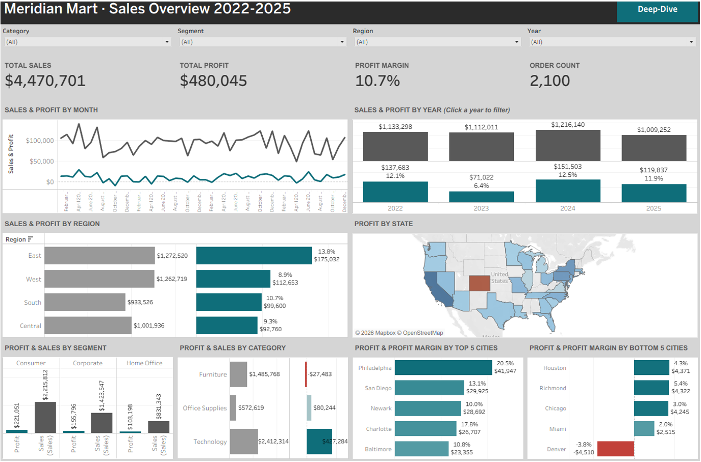
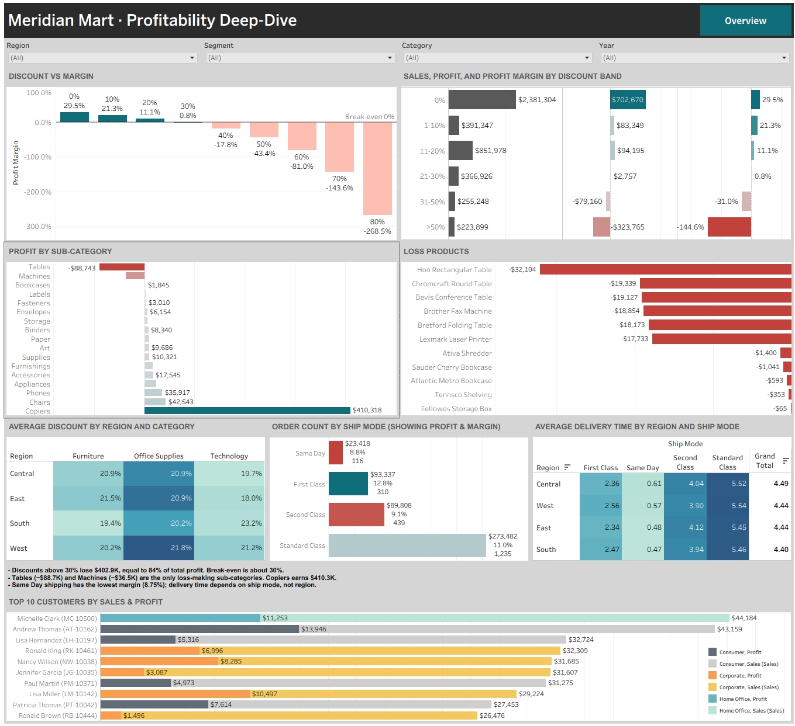

# Meridian Mart: Retail Sales & Profitability Dashboard (Tableau)

> Capstone project, 10Alytics Data Analytics programme. Fictional US superstore dataset provided by the course.

## Business problem
Meridian Mart's Chief Commercial Officer reported margin erosion across product lines and inconsistent regional reporting. The task was to find the root cause, quantify its financial impact, and give leadership an interactive dashboard.

## Data
| Table | Rows | Role |
|---|---|---|
| Sales | 4,413 | Fact table: orders, dates, sales, quantity, discount, profit |
| LocationDim | 31 | City, state, region |
| CustomerDim | 520 | Customer name, segment |
| ProductDim | 64 | Category, sub-category, product |

Tables are joined with Tableau relationships on Location ID, Customer ID and Product ID. Period: Jan 2022 to Dec 2025.

## What I built
- **Overview page:** KPI tiles, monthly and yearly trend (click a year to filter), region, state map, segment, category, top and bottom 5 cities.
- **Deep-Dive page:** margin by discount level with break-even line, discount bands, sub-category profit, loss-making products, discount heatmap, ship mode, delivery time, top 10 customers.
- **Techniques:** calculated fields (Profit Margin, Order Count, Delivery Days, Discount Band), LOD expressions (`{FIXED [Customer ID] : SUM([Sales])}`), parameters (Top N, Select Measure), filter and highlight actions, navigation buttons.

## Key findings
| Metric | Value |
|---|---|
| Total sales | $4,470,701 |
| Total profit | $480,045 |
| Profit margin | 10.7% |
| Orders | 2,100 |

1. **Discounting drives the margin loss.** Margin falls from 29.5% at 0% discount to 0.8% at 30% and −17.8% at 40%. The 999 lines discounted above 30% lose **$402.9K, equal to 84% of total profit**.
2. **Profit is concentrated in one product line.** Copiers earn $410.3K (85% of profit). Tables (−$88.7K) and Machines (−$36.5K) lose $125.2K together; 11 of 64 products are loss-making.
3. **West underperforms.** West sales ($1.26M) match East ($1.27M), but West earns $62.4K less profit (8.9% vs 13.8% margin). Denver is the only loss-making city.
4. **Trend.** Margin fell to 6.4% in 2023; sales fell 17.0% in 2025.
5. **Fulfilment.** Same Day shipping has the lowest margin (8.8%). Delivery time depends on ship mode, not region (4.40 to 4.49 days in every region).

## Recommendations
1. Cap line discounts at 20% and require approval above 30%.
2. Reprice or delist the 6 Table and Machine products that each lose $17K to $32K.
3. Protect Copiers pricing and bundle around it.
4. Run a pricing audit in West cities.
5. Add a Same Day shipping fee or minimum order value.

## Data quality note
100 customer names are shared by different Customer IDs, so all customer rankings use Customer ID, not name.

## Files
| File | Contents |
|---|---|
| `Meridian_Mart_Dashboard.twbx` | Tableau packaged workbook |
| `Meridian_Mart_Sales_Review.pptx` | 12-slide management presentation |
| `images/overview.png`, `images/deep-dive.png` | Dashboard screenshots |

## Dashboard

